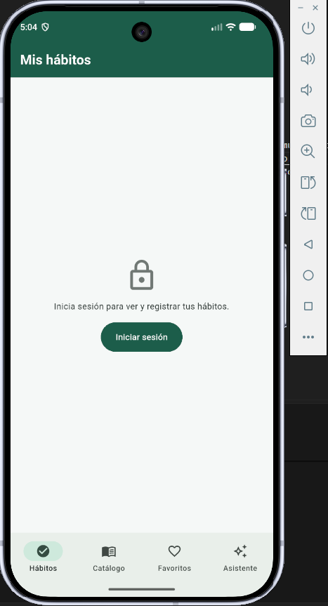
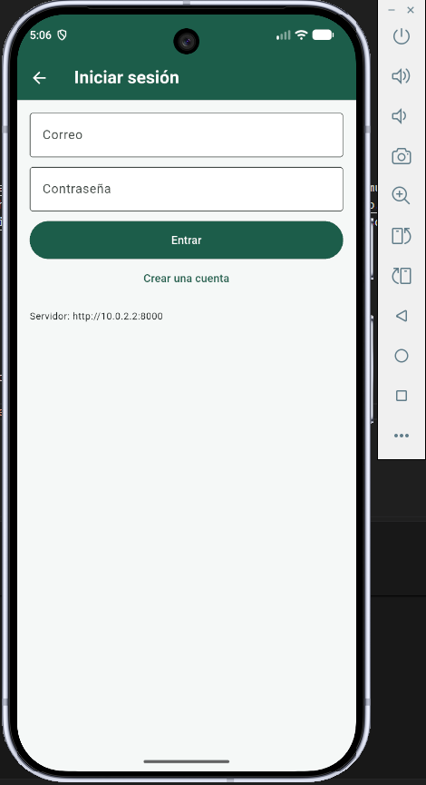
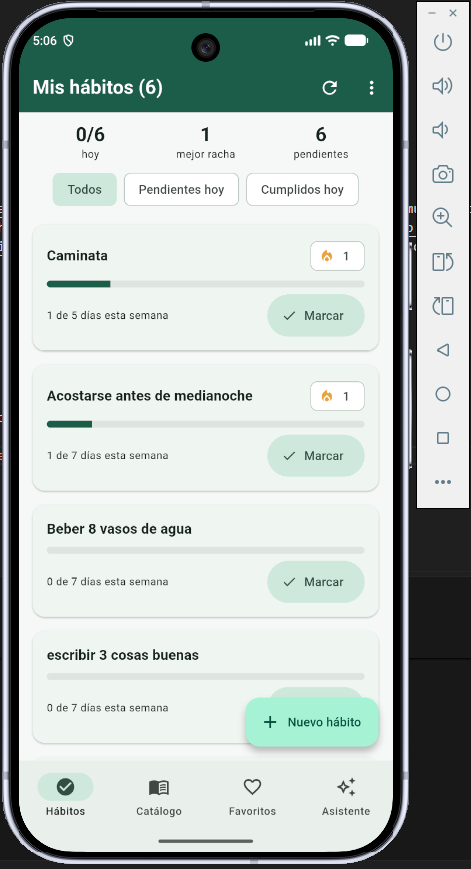
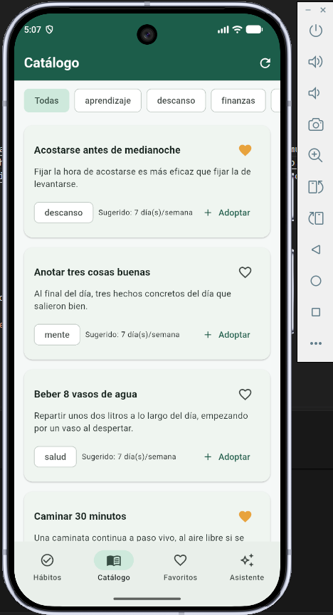
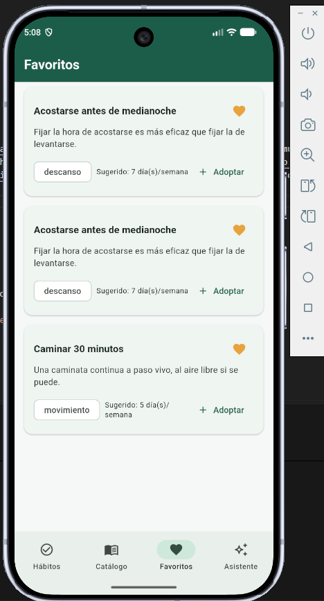
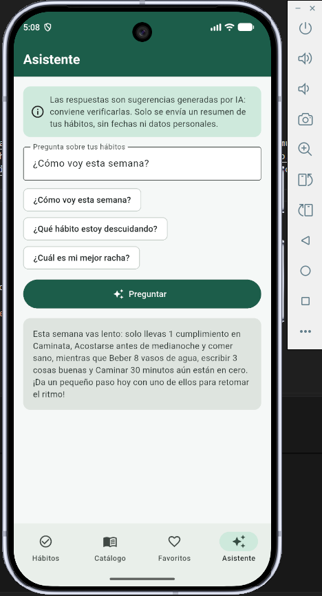

# seguimiento-habitos-app

App Flutter (Android) para construir hábitos y sostenerlos: cada persona crea
sus hábitos, los marca cada día, ve su racha y su avance semanal, adopta
sugerencias de un catálogo y le pregunta a un asistente de IA cómo va su semana.

La guía completa para levantar el proyecto paso a paso está en el
[README principal](../README.md); este documento es el resumen de la entrega.

## Capturas de pantalla

| Inicio de sesión | Autenticación | Mis hábitos |
|:---:|:---:|:---:|
|  |  |  |

| Catálogo | Favoritos | Asistente |
|:---:|:---:|:---:|
|  |  |  |

## Qué incluye

- [x] Registro, inicio y cierre de sesión con **JWT** contra un backend propio (FastAPI).
- [x] Lista principal con estados de **carga, vacío y error**, y aviso cuando muestra la copia guardada sin conexión.
- [x] **Persistencia local** que sobrevive al reinicio: favoritos del catálogo en Hive.
- [x] **Datos remotos protegidos** por autorización: CRUD de hábitos y sus marcas diarias.
- [x] **Datos reales**: el catálogo (20 sugerencias) sale del backend (`GET /sugerencias/`), no está escrito en el código.
- [x] **Asistente con IA** mediante un proxy propio, sin claves en la app.
- [x] **Estado compartido con GetX** (`AuthController`, `HabitosController`, `CatalogoController`, `AsistenteController`).
- [x] Extra: **modo oscuro** automático según el sistema.

## Cómo ejecutarla

Requisitos: Flutter 3.24+ (desarrollado con 3.47.5), Git, Node.js 18+ y, para
el backend, Docker Desktop **o** Python 3.11+ con uv. Las dos carpetas van una
al lado de la otra:

```text
proyecto-habitos/
├── seguimiento-habitos-app/        ← esta app
└── seguimiento-habitos-backend/    ← el backend
```

1. **Backend** (terminal 1, desde `proyecto-habitos/`). Repositorio:
   `https://github.com/pedropico/seguimiento-habitos-pedro.git`

   ```bash
   # Ejecutar cd .. si aún se está dentro del directorio seguimiento-habitos-app
   git clone https://github.com/pedropico/seguimiento-habitos-pedro.git seguimiento-habitos-backend
   cd seguimiento-habitos-backend
   cp .env.example .env          # en PowerShell: copy .env.example .env
   docker compose up --build
   ```

   Sin Docker: `uv sync`, `uv run alembic upgrade head` y
   `uv run uvicorn app.main:app --host 0.0.0.0 --port 8000`.
   Comprobar con `curl http://localhost:8000/health` → `{"status":"ok"}`.

2. **Proxy del asistente** (terminal 2, desde `proyecto-habitos/`):

   ```bash
   cd seguimiento-habitos-app
   node mock-server/mock-server.js
   ```

   Arranca en modo reglas, sin ninguna clave. Para IA real, ver
   [`mock-server/README.md`](../mock-server/README.md).

3. **App** (terminal 3, dentro de `seguimiento-habitos-app/`):

   ```bash
   flutter create . --platforms=android --project-name seguimiento_habitos_app   # solo la primera vez
   flutter pub get
   flutter run
   ```

4. **Direcciones por entorno.** Emulador Android: por defecto usa
   `http://10.0.2.2:8000` (backend) y `http://10.0.2.2:3000` (proxy), sin
   configurar nada. Dispositivo físico: pasar la IP del computador en la red
   local con
   `flutter run --dart-define=API_BASE_URL=http://192.168.1.X:8000 --dart-define=LLM_BACKEND_URL=http://192.168.1.X:3000`.

## APK

Descárgalo desde la sección **Releases** del repositorio
(<https://github.com/pedropico/seguimiento-habitos-app/releases>). Se genera
con GitHub Actions al subir una etiqueta `v*` (ver
`.github/workflows/release-apk.yml`). Para probarlo, instálalo en un emulador
con el backend y el proxy encendidos como se explica arriba:

```bash
adb uninstall com.example.seguimiento_habitos_app   # si había una versión de depuración
adb install -r seguimiento-habitos-app-v1.0.0.apk
```

## Arquitectura

```text
screens/       pantallas (solo interfaz)
widgets/       piezas de interfaz reutilizables
controllers/   estado compartido con GetX
repositories/  deciden: ¿servidor o caché local?
services/      HTTP (backend y proxy), Hive y almacenamiento seguro
models/        hábitos, registros, sugerencias del catálogo
```

Cuando la pantalla de Hábitos pide la lista, `HabitosController` pone el estado
en *cargando* y le pide los datos a `HabitosRepository`. El repositorio intenta
primero el servidor (`HabitosApiService`, con el token JWT en la cabecera);
si responde, guarda una copia en Hive y la devuelve. Si falla por
infraestructura (sin conexión, tiempo agotado, 5xx) devuelve la copia guardada
y la pantalla muestra un aviso con la hora de la última sincronización; si
falla por sesión o petición (401, 403, 404, 409) muestra el error, nunca datos
viejos. Ninguna pantalla hace llamadas HTTP: el detalle está en
[ARQUITECTURA.md](ARQUITECTURA.md).

## Decisión técnica propia

**Leer el `sub` del JWT en vez de pedir el perfil.** Cada persona tiene su
propia caja de Hive (`habitos_<id>`), porque Hive guarda sin cifrar y dos
personas que compartan el teléfono mezclarían sus datos. Para nombrar la caja
hace falta el id del usuario, y el backend no expone `GET /usuarios/me`.

| Opción | Por qué se descartó o se eligió |
|---|---|
| Añadir `/usuarios/me` al backend | El backend es un entregable cerrado de otro módulo; tocarlo por una necesidad del cliente invierte la dependencia. |
| Usar el correo del formulario | La identidad la decide el servidor, no el formulario: el mismo correo con otra capitalización abriría otra caja. |
| **Leer el `sub` del token** ✅ | El id ya viaja dentro del JWT, firmado por el servidor; no cuesta una petición de más. |

La app **lee** el token pero no lo **verifica** (eso exige la clave secreta del
servidor): el `sub` solo nombra una caja local y nunca decide permisos. Cada
petición la valida el servidor, y un 401 cierra la sesión.

## Tecnologías

| Paquete | Para qué se usa |
|---|---|
| `get` | Estado compartido (controladores), navegación y registro de dependencias |
| `dio` | Peticiones HTTP al backend y al proxy, con interceptores para el token y el 401 |
| `flutter_secure_storage` | Guardar el token JWT cifrado (Keystore en Android) |
| `hive` / `hive_flutter` | Caché local de hábitos y catálogo, y favoritos |
| `path_provider` | Ubicar la carpeta donde Hive guarda sus cajas |
| `flutter_localizations` | Textos del sistema (fechas, diálogos) en español |
| `flutter_lints` | Reglas del analizador estático (`flutter analyze`) |

El proxy del asistente (`mock-server/`) es Node.js sin dependencias externas.

## Seguridad

- No hay claves ni secretos en el repositorio: `.env` está en `.gitignore` y
  solo se versiona `.env.example`, sin valores reales. La CI busca patrones de
  clave en cada cambio.
- El token de sesión se guarda en `flutter_secure_storage`, nunca en Hive ni en
  SharedPreferences, y `ReporteErrores` lo reemplaza por asteriscos antes de
  registrar cualquier error.
- La clave de IA (`GEMINI_API_KEY`) vive solo en una variable de entorno del
  proxy; la app no la conoce.
- La contraseña no se guarda en ningún lado: el servidor solo almacena su hash.

## Créditos y licencias

- **Backend**: `seguimiento-habitos-pedro` (`https://github.com/pedropico/seguimiento-habitos-pedro.git`) — FastAPI, SQLAlchemy 2.0, Alembic y
  MCP. Proyecto del módulo 2.
- **Paquetes**: los de la tabla de tecnologías, publicados en
  [pub.dev](https://pub.dev) con licencias abiertas: MIT (`get`, `dio`), BSD
  (`flutter_secure_storage`, `path_provider` y los paquetes de Flutter) y
  Apache 2.0 (`hive`, `hive_flutter`). Se ven en la app: menú ⋮ → **Acerca de**.
- **Catálogo de hábitos**: lo suministra el backend, elaborado para este
  proyecto a partir de recomendaciones generales de salud y productividad. No
  reproduce ninguna fuente con derechos.
- **Proveedor de IA**: Google Gemini a través del proxy, opcional. El modo de
  reglas no usa ningún servicio externo.
